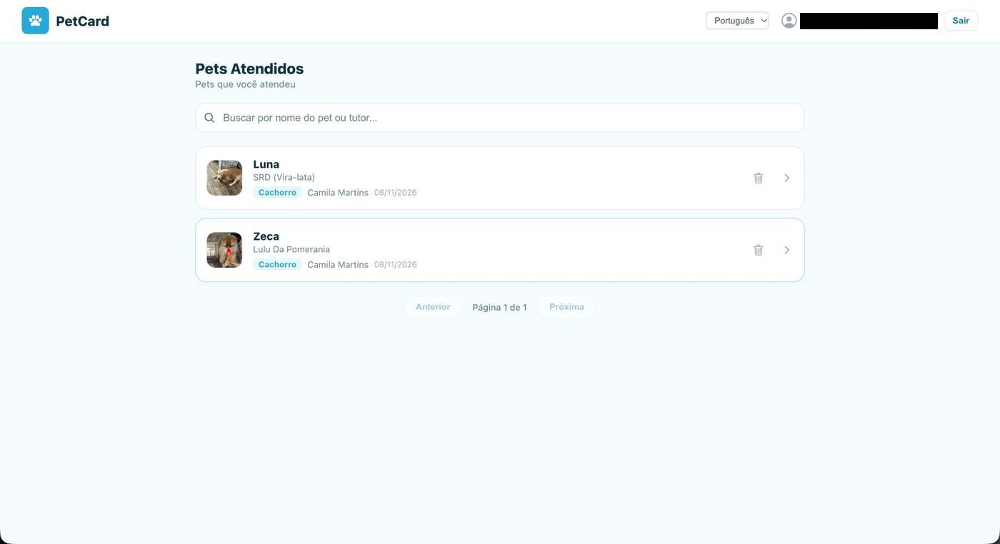
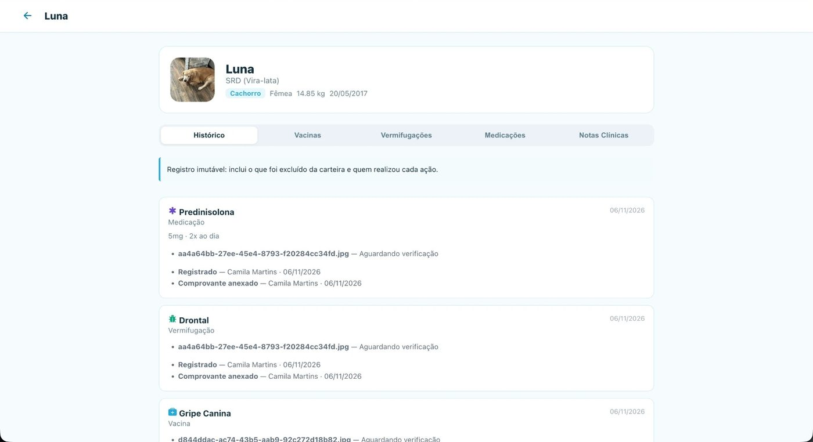
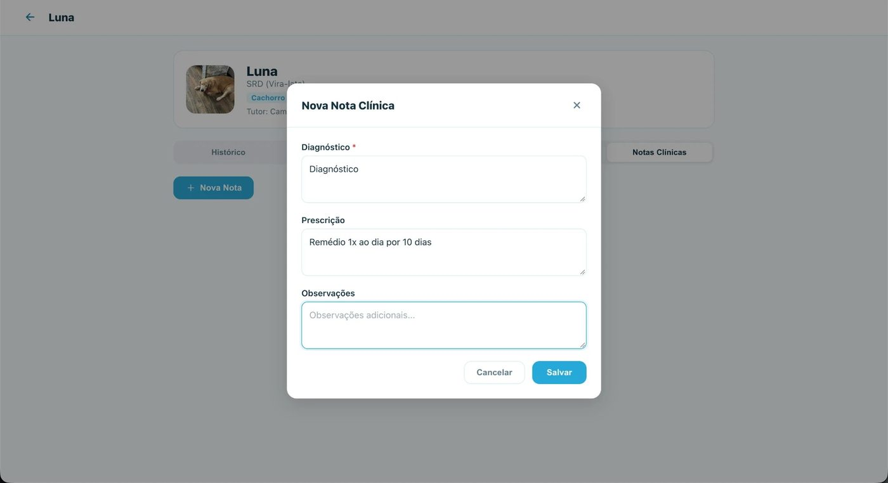
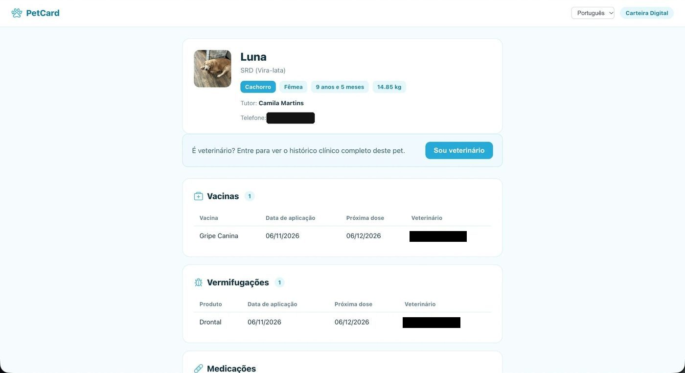

<div align="center">


# PetCard Web

**Área do veterinário do PetCard e páginas públicas da carteira digital: o veterinário lê o QR Code do pet, vê o histórico completo e registra o atendimento, que aparece na hora no app do tutor.**

[](https://github.com/PetCardOrg/petcard-web/actions/workflows/ci.yml)
[](https://github.com/PetCardOrg/petcard-web/actions/workflows/ci.yml)
[](LICENSE)
[](https://petcard-web.vercel.app)

[](https://react.dev)
[](https://vite.dev)
[](https://www.typescriptlang.org)
[](https://vitest.dev)

[Telas](#telas) · [Funcionalidades](#funcionalidades) · [Stack](#stack) · [Como rodar](#como-rodar) · [Testes](#testes) · [Ecossistema](#ecossistema)

</div>

---

## Telas

<div align="center">






<sub>Pets atendidos · Prontuário com histórico imutável · Nova nota clínica · Carteira pública aberta pelo QR Code</sub>

</div>

## Funcionalidades

**Área do veterinário** (`/vet`)

- 🪪 Cadastro com o CRMV conferido no CFMV e o nome preenchido a partir do registro
- 📋 Painel com os pets atendidos, com busca por pet ou tutor e paginação
- 🔍 Acesso a um pet novo pela carteira pública lida no QR Code (botão **Sou veterinário**)
- 🩺 Registro de vacinas, vermífugos, medicações e notas clínicas, assinados com nome e CRMV
- ✅ Verificação dos comprovantes que o tutor anexou
- 🧾 Histórico imutável: mostra também o que foi excluído e quem fez cada ação
- 👤 Perfil do veterinário com foto e edição de dados

**Páginas públicas** (sem login)

- 📱 Carteira digital do pet aberta pelo QR Code ou pelo link compartilhado (`/card/:token`)
- 🏷️ Página de pet perdido aberta pelo QR da coleira (`/achei/:token`), com o contato do tutor

Toda a interface está em português e inglês.

## Stack

| Camada | Tecnologia |
|---|---|
| Framework | React 19 + Vite 8 + TypeScript |
| Roteamento | React Router 7 (rotas protegidas por `ProtectedRoute`) |
| HTTP | Cliente próprio `apiFetch` (`src/services/api.ts`) |
| Autenticação | JWT emitido pela [petcard-api](https://github.com/PetCardOrg/petcard-api) |
| i18n | i18next + react-i18next (pt-BR e en-US) |
| Contratos | DTOs do [`@petcardorg/shared`](https://github.com/PetCardOrg/petcard-shared) |
| Testes | Vitest + Testing Library (jsdom) |
| Hospedagem | Vercel ([ADR-012](https://github.com/PetCardOrg/petcard-docs/blob/main/architecture/adr/012-dominio-de-producao-subdominios-gratuitos-e-vercel.md)) |

```
src/
├── components/   componentes reutilizáveis
├── contexts/     sessão do veterinário
├── hooks/        hooks compartilhados
├── i18n/         traduções pt-BR e en-US
├── pages/        uma pasta por tela, com o teste ao lado
├── services/     chamadas à API
└── test/         utilitários de teste
```

## Como rodar

**Pré-requisitos:** Node.js 20 LTS, npm 10, a [petcard-api](https://github.com/PetCardOrg/petcard-api) rodando em `http://localhost:3000` e um token do GitHub com escopo `read:packages` (para baixar o `@petcardorg/shared`).

```bash
git clone https://github.com/PetCardOrg/petcard-web.git
cd petcard-web

export NODE_AUTH_TOKEN=<seu_token_read_packages>
npm install

cp .env.example .env
# preencha VITE_API_URL=http://localhost:3000
# (ou VITE_API_URL=/api para usar o proxy do Vite, útil ao testar pelo celular via túnel)
npm run dev              # http://localhost:5173
```

Com o seed da API (`npm run db:seed` na petcard-api), já existem contas de veterinário para entrar.

| Comando | O que faz |
|---|---|
| `npm run dev` | Servidor de desenvolvimento |
| `npm run build` | Checagem de tipos e build de produção |
| `npm run preview` | Serve o build localmente |
| `npm run lint` | ESLint |
| `npm test` · `npm run test:cov` | Testes, com cobertura |

## Testes

As telas são testadas com Vitest e Testing Library seguindo a política de **cobertura de confiança** ([ADR-006](https://github.com/PetCardOrg/petcard-docs/blob/main/architecture/adr/006-cobertura-de-confianca.md)): o teste existe quando a falha dele afetaria o veterinário ou o tutor. O CI roda `lint`, `test:cov` e `build` em todo push e PR para `main` e `develop`, e a catraca de cobertura (84/80/73/84) impede regressão.

## Ecossistema

| Repositório | O que é |
|---|---|
| [petcard-api](https://github.com/PetCardOrg/petcard-api) | API REST em NestJS |
| **petcard-web** | Área do veterinário (você está aqui) |
| [petcard-mobile](https://github.com/PetCardOrg/petcard-mobile) | App do tutor em React Native + Expo |
| [petcard-shared](https://github.com/PetCardOrg/petcard-shared) | DTOs e enums compartilhados |
| [petcard-docs](https://github.com/PetCardOrg/petcard-docs) | Documentação central, ADRs e board |

Para contribuir, siga o [guia de contribuição](https://github.com/PetCardOrg/petcard-docs/blob/main/CONTRIBUTING.md). Projeto de TCC em Ciência da Computação, UNIFOR, 2026, por Álvaro Araújo, Camila Martins e Ricardo Temporal. Licença [MIT](LICENSE).
